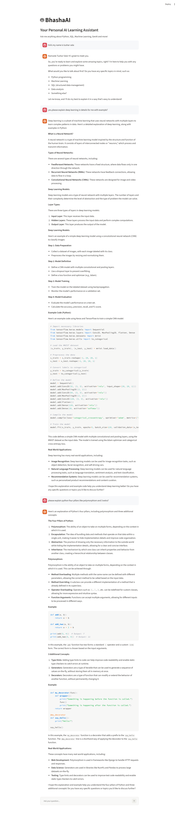
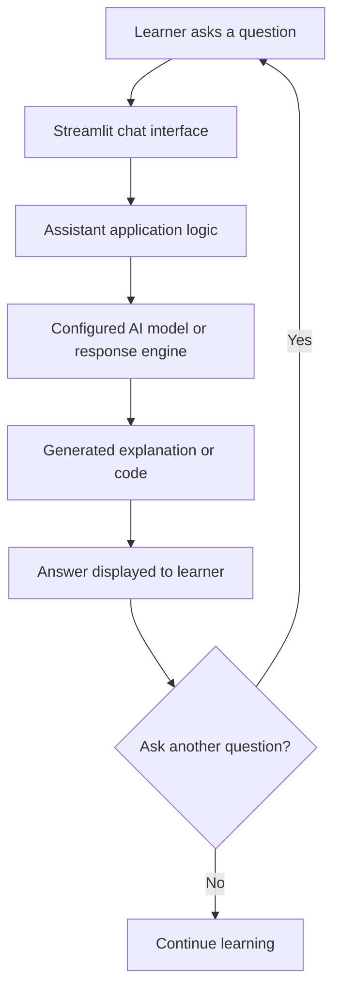
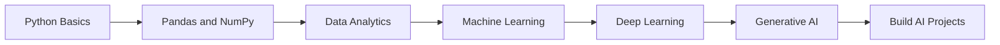

# 🤖 BhashaAI

### Your Personal AI Learning Assistant

**Learn. Ask. Explore. Build.**

An interactive AI learning companion for Python, SQL, Data Analytics,
Machine Learning, Deep Learning, Generative AI, and programming
concepts.


------------------------------------------------------------------------

## 📌 About BhashaAI

**BhashaAI** is a Streamlit-based personal AI learning assistant
designed to make technical learning easier, clearer, and more
interactive.

Users can ask questions about programming and AI topics and receive
explanations, examples, and practical guidance through a conversational
interface.

**Project goal:** Make difficult technical concepts easier to understand
through an AI-powered learning experience.

## 🖥️ Application Preview

Add your application screenshot to the repository at
`assets/bhashaai-demo.png`, then this preview will appear here:



> If your screenshot is stored in a different folder, update the image
> path above. You can also add a demo GIF as `assets/bhashaai-demo.gif`.

## ✨ Features

| Feature              | Description                                                    |
|----------------------|----------------------------------------------------------------|
| 💬 AI Chat Interface | Ask technical questions through a conversational interface.    |
| 🐍 Python Learning   | Learn Python syntax, functions, OOP, libraries, and examples.  |
| 🗄️ SQL Guidance      | Understand queries, joins, grouping, and database concepts.    |
| 📊 Data Analytics    | Explore data cleaning, analysis, visualization, and reporting. |
| 🤖 Machine Learning  | Learn algorithms, model training, and evaluation.              |
| 🧠 Deep Learning     | Explore neural networks, CNNs, RNNs, and Transformers.         |
| ✨ Generative AI     | Learn LLMs, prompt engineering, embeddings, and RAG.           |
| 💻 Code Explanations | Request sample code and step-by-step explanations.             |

*Available features depend on the modules and AI provider configured in
your current application.*

## 🎯 Learning Areas

<details>
<summary><strong>🐍 Python Programming</strong></summary>

- Variables, data types, and operators
- Conditions, loops, and functions
- Lists, tuples, sets, and dictionaries
- File handling and exception handling
- Object-oriented programming
- NumPy, Pandas, and Matplotlib
- Practical coding exercises

</details>

<details>
<summary><strong>🗄️ SQL & Databases</strong></summary>

- SELECT, WHERE, and ORDER BY
- GROUP BY and HAVING
- INNER, LEFT, RIGHT, and FULL JOIN
- Subqueries and common table expressions
- Aggregate and window functions
- Database design fundamentals

</details>

<details>
<summary><strong>📊 Data Analytics</strong></summary>

- Data cleaning and preprocessing
- Missing-value treatment
- Exploratory data analysis
- Data visualization
- Excel and Power BI concepts
- Business questions and KPI analysis

</details>

<details>
<summary><strong>🤖 Machine Learning & Deep Learning</strong></summary>

- Supervised and unsupervised learning
- Regression and classification
- Decision Trees and Random Forest
- Model evaluation and validation
- Neural networks and CNNs
- Overfitting, underfitting, and optimization

</details>

<details>
<summary><strong>✨ Generative AI</strong></summary>

- Large Language Models (LLMs)
- Prompt engineering
- Tokens and context windows
- Embeddings and vector databases
- Retrieval-Augmented Generation (RAG)
- AI application development concepts

</details>

## ⚙️ How It Works



At a high level, BhashaAI receives a question, processes it through the
configured assistant logic and AI response engine, and displays the
result in the chat interface.

## 🧰 Technology Stack

| Technology             | Purpose                                                   |
|------------------------|-----------------------------------------------------------|
| Python                 | Core application programming language                     |
| Streamlit              | Web interface and chat experience                         |
| AI model/provider      | Generates assistant responses, depending on configuration |
| SQLite (if configured) | Local storage for conversations or application data       |
| Git and GitHub         | Version control and project hosting                       |
| Visual Studio Code     | Development environment                                   |

## 📁 Project Structure

The following is a suggested structure. Update it to match the files
that actually exist in your repository.

``` text
BhashaAI/
│
├── app.py                 # Streamlit application entry point
├── requirements.txt       # Python dependencies
├── .env.example           # Example environment configuration
├── README.md              # Project documentation
│
├── assets/
│   ├── bhashaai-demo.png  # Application screenshot
│   └── bhashaai-demo.gif  # Optional demo animation
│
```

## 🚀 Installation and Setup

### 1. Clone the repository

Replace `YOUR_GITHUB_USERNAME` and `YOUR_REPOSITORY` with your GitHub
username and repository name.

``` bash
git clone https://github.com/YOUR_GITHUB_USERNAME/YOUR_REPOSITORY.git
```

### 2. Open the project directory

``` bash
cd YOUR_REPOSITORY
```

### 3. Create a virtual environment

**Windows PowerShell:**

``` powershell
py -3.11 -m venv .venv
.\.venv\Scripts\Activate.ps1
```

If PowerShell blocks activation, use Command Prompt:

``` bat
.venv\Scripts\activate.bat
```

### 4. Install dependencies

``` bash
python -m pip install --upgrade pip
pip install -r requirements.txt
```

### 5. Configure environment variables (if required)

If your configured AI provider requires an API key, create a local
`.env` file using the variable names expected by your application.

``` powershell
Copy-Item .env.example .env
```

Add your key locally. **Never commit `.env`, API keys, passwords, or
private credentials to GitHub.**

### 6. Start the application

``` bash
streamlit run app.py
```

Open the local URL displayed in your terminal. The default is:

``` text
http://localhost:8501
```

## 💡 Example Questions

Try asking BhashaAI:

- Explain Python functions with a simple example.
- What is the difference between a list and a tuple?
- Explain SQL joins with sample tables.
- What is the difference between supervised and unsupervised learning?
- Explain Random Forest Regression step by step.
- What is Retrieval-Augmented Generation (RAG)?
- How do embeddings and vector databases work?
- Give me a practical Pandas data-cleaning exercise.

## 🧪 Suggested Learning Journey



## 🔐 Security Notes

- Store secrets in environment variables.
- Add `.env` to `.gitignore`.
- Never expose API keys in screenshots, logs, or source code.
- Validate user input and handle AI provider errors gracefully.
- Avoid storing sensitive conversations unless necessary and
  appropriately protected.
- Add authentication and access controls before making the application
  available to external users.

## 🛣️ Project Roadmap

- [x] Build a Streamlit-based learning assistant interface
- [x] Add conversational question-and-answer interaction
- [ ] Add configurable AI model providers
- [ ] Add English, Hindi, and Gujarati response modes
- [ ] Add topic-based learning paths
- [ ] Add Python coding practice and quizzes
- [ ] Add chat history and conversation management
- [ ] Add document upload and question answering (RAG)
- [ ] Add source references for document-grounded answers
- [ ] Add user authentication and protected profiles
- [ ] Deploy the application and add production monitoring

*The roadmap is a list of planned improvements. Only mark an item
complete when it is implemented in your repository.*

## 🤝 Contributing

Suggestions and contributions are welcome.

1.  Fork this repository.
2.  Create a feature branch.
3.  Make your changes.
4.  Test your changes.
5.  Open a pull request describing your contribution.

## 🐛 Issues and Feedback

If you find a bug or have an improvement idea, open an issue in the
GitHub repository. Include clear reproduction steps and remove private
information from logs or screenshots.

## 👨‍💻 Author

**Tushar Vala**

Aspiring Data Analyst \| AI/ML Developer \| Generative AI Enthusiast


------------------------------------------------------------------------

<div align="center">

**BhashaAI — Learn something new, one question at a time.** 🚀

Built with Python and Streamlit by Tushar Vala.

</div>
